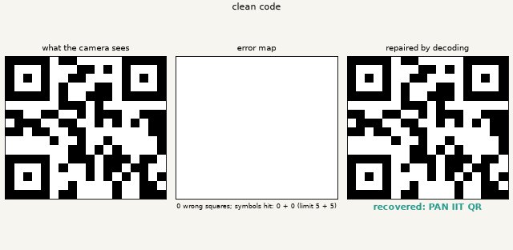
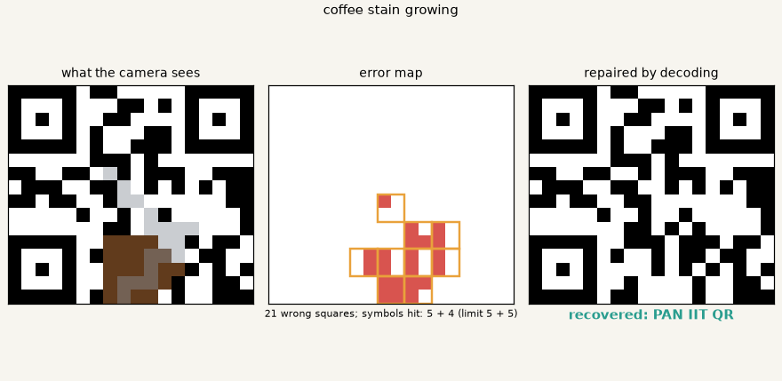
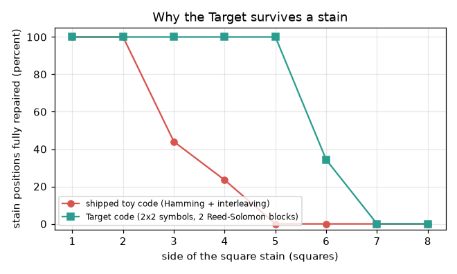

# What you are building toward

A small toy code is scratched twice and then stained by a growing coffee blob. On the left you see what the camera sees. In the middle, an error map marks every wrong square. On the right, the decoder has repaired the code and prints the recovered message, until the damage finally becomes too large. Your goal over the coming sessions: build the repair machinery yourself, then make it survive a blob.

*Target: a toy code is scratched, stained and repaired, with its error map*

*Target, one frame: damaged code, error map, recovered message*

*Why the Target survives more: success against damage for the shipped and the Target code*

These results come from a private reference build. The code is not published; the roadmap shows the path so you can build your own.

Live links:

- [Math Visual Studio (Studio home)](https://krunalpanchal1995.github.io/studio/)
