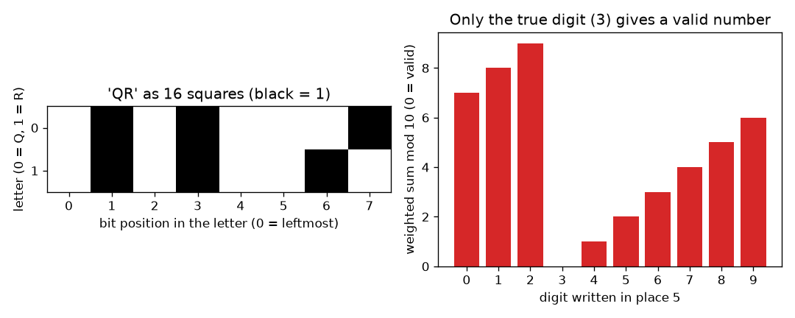
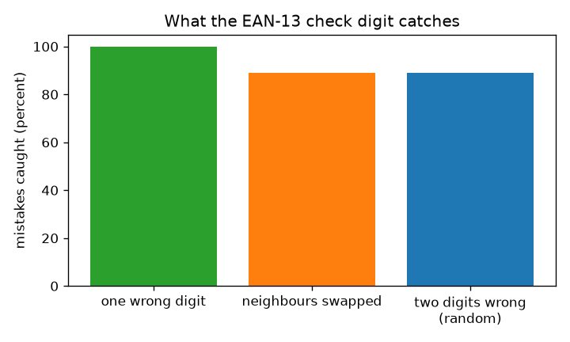

# Session 1: Squares of data and the check digit

*Level 1 (conceptual interactive model) · about 60 minutes · openqrcode*

> This is a simplified educational model. It is not a validated design tool and must not be used for real structures, electrical installations, vehicles, industrial processes or medical decisions.

**Prerequisites**

- Arithmetic: multiplying, adding and remainders.
- You have read PRIMER.md and run `python start.py 1` once.

**Learning objectives.** After this session you can:

- Explain how text becomes a grid of black and white squares.
- Compute the EAN-13 check digit of a 12-digit number by hand and in Python.
- Verify real-format numbers with the check.
- State what a check digit catches (and what it misses) and why it cannot repair anything.

## A. Real-world problem
A till scans thousands of barcodes a day. A smudge or a mistyped digit could turn a tin of beans into a tin of paint. The scanner must notice that the number it read is probably wrong, using only the number itself. How can 13 digits carry their own proof-reader? (General education only: this is a simplified model, not the full barcode standard.)

## B. Concept and theory
Everything a computer stores is a number, and every number can be written with 0s and 1s. Draw 1 as a black square and 0 as a white square: the letter A (code 65 = 64 + 1) is the eight squares 01000001. A 2D code is just many such squares in a grid. A shop barcode (EAN-13) holds 13 digits. The first 12 carry the product; the 13th is a check digit. Multiply the digits by weights 1, 3, 1, 3, ... from the left, add them up (the weighted sum S), and choose the last digit so that S ends in 0, that is S mod 10 = 0 (the remainder after dividing by 10). A reader recomputes S: if the remainder is not 0, it rejects the number. Changing one digit by x changes S by w times x (w is 1 or 3), and neither 1 nor 3 shares a factor with 10, so the remainder always changes: every single wrong digit is caught. Swapping two neighbouring digits a and b changes S by 2 times (a minus b), which is a multiple of 10 only when a and b differ by exactly 5, so those swaps slip through. A check digit tells you THAT something is wrong, not WHERE, so it cannot repair the number.

| Symbol | Meaning | Unit |
|---|---|---|
| d_i | the i-th digit of the number, i = 1 to 13 | no unit |
| w_i | weight of place i (1 for odd i, 3 for even i) | no unit |
| S | weighted sum of the digits | no unit |
| c | check digit (13th digit) | no unit |
| a, b | two neighbouring digits that get swapped | no unit |

**Assumptions**

- Digits are read correctly as digits; we study mistakes in WHICH digit is read, not the bar widths.
- Mistakes are random: any wrong digit is equally likely.
- UPC-A numbers (12 digits) follow the same rule when a 0 is written in front.

$$ S=\sum_{i=1}^{13} w_i d_i,\qquad w_i=\begin{cases}1 & i\ \text{odd}\\ 3 & i\ \text{even}\end{cases} $$

$$ \text{valid}\iff S\equiv 0 \pmod{10},\qquad c=\big(10-S_{12}\bmod 10\big)\bmod 10 $$

$$ \Delta S=2\,(a-b)\ \text{for swapped neighbours with weights 1 and 3;}\quad \text{missed only if } a-b=\pm 5 $$

## C. Visual explanation
The left figure shows the word QR as 16 squares in two rows of eight; black squares are 1s. The right figure takes the real-format number 4006381333931, replaces its fifth digit by each digit from 0 to 9 and plots the weighted sum mod 10: only the true digit 3 gives 0 (green), the other nine are rejected (red). The second figure compares three kinds of mistake: all single wrong digits are caught, and neighbour swaps and double errors are caught about 89 percent of the time.

*Left: the word QR as 16 squares. Right: only the true digit passes the check.*

*A check digit catches every single wrong digit, and about 89 percent of swaps and double errors.*

## D. Interactive simulation
Run the lesson (`python start.py 1`), then open the live app: [Session 1: break a real-format barcode number](https://krunalpanchal1995.github.io/openqrcode/session-01/) (or `app.html` in this folder). Choose a place and a digit. Watch the weighted sum and the remainder change, then switch to the graph and see which digit makes the number pass.

**Challenge.** Put the digit back that makes the number pass the check in place 5.

## E. Worked example and experiment
**Problem.** Find the check digit of the 12 digits 400638133393 and say whether 4006381333931 is valid.

1. Write the digits with weights 1, 3, 1, 3, ...: 4x1, 0x3, 0x1, 6x3, 3x1, 8x3, 1x1, 3x3, 3x1, 3x3, 9x1, 3x3.
2. Products: 4, 0, 0, 18, 3, 24, 1, 9, 3, 9, 9, 9.
3. Sum of the 12 products: S = 4 + 0 + 0 + 18 + 3 + 24 + 1 + 9 + 3 + 9 + 9 + 9 = 89.
4. The next multiple of 10 above 89 is 90, so the check digit is 90 - 89 = 1.
5. The full number is 4006381333931. Its 13 weighted terms add to 89 + 1x1 = 90, and 90 mod 10 = 0: valid.

**Answer.** The check digit is 1, so 4006381333931 is valid (weighted sum 90).

**Experiment.** Pick a packaged product at home, read the 13 digits under its barcode and apply the rule to the first 12; the result should equal the 13th. Some products carry 8-digit (EAN-8) or 12-digit (UPC-A) codes: for UPC-A write a 0 in front first. If it does not match, you have probably misread a digit, which is the check digit doing its job. Model versus reality: the scanner reads bar widths, not digits, and uses further checks on the bars themselves; this model only covers the digit string.

## F. Assessment and design challenge
**Question type A: Conceptual.** Why can the check digit tell you that a number is wrong, but not which digit is wrong? What extra would you need to repair it?

Hint

The check gives one number between 0 and 9. How many different mistakes give the same remainder?

Step-by-step solution

The check compresses all 13 digits into one remainder. A remainder that is not 0 says 'some place changed', but many different places and digits give the same remainder, so it cannot name one. To repair a mistake you need several overlapping checks whose answers, together, point at one place. That is what the parity checks of Session 2 do.

**Question type B: Numerical.** Find the check digit for the 12 digits 590123412345 and show the weighted sum.

Hint

Use weights 1, 3, 1, 3, ... from the left. The check digit brings the sum up to the next multiple of 10.

Step-by-step solution

Products: 5x1=5, 9x3=27, 0x1=0, 1x3=3, 2x1=2, 3x3=9, 4x1=4, 1x3=3, 2x1=2, 3x3=9, 4x1=4, 5x3=15. Sum: 83. Next multiple of 10: 90, so the check digit is 7 and the number is 5901234123457. Sanity check: 83 + 7 = 90, which ends in 0.

**Question type C: Graph and simulation interpretation.** In the graph of the weighted sum mod 10 against the digit written in place 6 (weight 3), how much does the remainder move when the digit goes up by 1? Why does exactly one digit give 0?

Hint

Each step of 1 in the digit changes S by the weight of the place. Place 5 has weight 1 and its graph rises by 1 per step.

Step-by-step solution

With weight 3 the remainder jumps by 3 (mod 10) at each step: for the example number 4006381333931 the remainders for the digits 0 to 9 in place 6 are 6, 9, 2, 5, 8, 1, 4, 7, 0, 3. Because 3 and 10 share no factor, the ten digits give ten different remainders, so exactly one of them gives 0. The same holds for weight 1.

**Question type D: Design and optimisation challenge.** Design: a library wants a check digit for 6-digit member numbers that catches EVERY swap of two neighbouring digits, which the EAN-13 rule does not (it misses digits that differ by 5). Propose a rule and state its cost.

Hint

Try weights that differ by something sharing no factor with the modulus, and think about which modulus works.

Step-by-step solution

Use a weighted sum modulo 11 with weights 7, 6, 5, 4, 3, 2 and choose the check value so that the total is a multiple of 11 (ISBN-10 works in a similar way). A swap of neighbours a, b changes the sum by (weight difference = 1) times (a minus b), and a - b is between -9 and 9 and non-zero, so it is never a multiple of 11: every swap is caught, and so is every single wrong digit. Cost: the check value can be 10, which needs an extra symbol (ISBN-10 writes X), so the numbers are no longer pure digits. Trade-off: stronger protection against swaps versus a more awkward format.

Score yourself with [RUBRIC.md](../../RUBRIC.md). Print the [activity sheet](activity_sheet.md) to work on paper.

## Common misconceptions
| Common misconception | What is actually true |
|---|---|
| A check digit corrects mistakes. | It only detects them. It says 'something is wrong', not what or where. |
| If the check passes, the number is certainly right. | Some mistakes slip through: neighbour swaps of digits that differ by 5, and about one random double error in nine. |
| Black and white squares must hold something visual. | The squares are only a way to store the bits 1 and 0; any pair of opposite shades works. |
| The digits under a barcode are what the scanner reads. | The scanner reads the bars; the digits are a human-readable copy that follows the same rule. |

## Glossary
- **bit**: one 0 or 1; drawn as a white or black square
- **check digit**: an extra digit computed from the others so that a reader can test the number
- **weighted sum**: the digits multiplied by weights and added
- **mod 10**: the remainder after dividing by 10; 83 mod 10 = 3
- **EAN-13**: the 13-digit shop barcode standard

## Finish
1. Do the three coding tasks in [exercises.md](exercises.md).
2. Run `python start.py 1` again after your changes. It ends with the checkpoint; when it prints `PASS`, you are done. (Checkpoint only: `python start.py check 1`.)

Next: [Session 2](../session-02/README.md)
