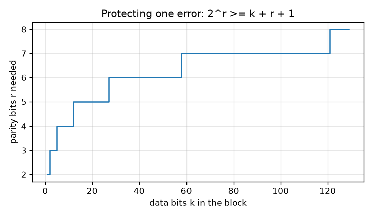
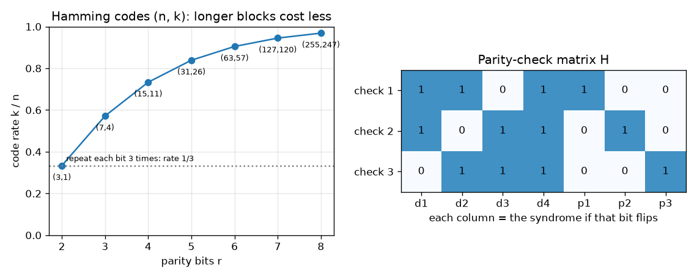

# Session 2: Parity bits and the Hamming(7,4) code

*Level 2 (mathematical engineering model) · about 75 minutes · openqrcode*

> This is a simplified educational model. It is not a validated design tool and must not be used for real structures, electrical installations, vehicles, industrial processes or medical decisions.

**Prerequisites**

- Session 1: bits and the check digit.
- Adding bits modulo 2 (1 + 1 = 0) is explained in Section B.

**Learning objectives.** After this session you can:

- Compute parity bits and a Hamming(7,4) codeword by hand and with the matrix G.
- Find and fix a single flipped bit with the syndrome H r.
- Explain code rate and redundancy as a trade-off.
- Use 2^r >= k + r + 1 to design how many parity bits a block needs.

## A. Real-world problem
A QR code on a bus ticket gets a scratch across a few squares, yet the gate still opens. The code must not only notice damage but repair it. What is the cheapest way to add extra bits so that ANY one flipped bit among them can be located and fixed? (General education only: this is a simplified model of the real, much stronger codes in QR standards.)

## B. Concept and theory
Work with bits and add modulo 2: 0+0=0, 0+1=1, 1+1=0 (the remainder after dividing by 2). The parity of some bits is their sum mod 2. Hamming(7,4) takes 4 data bits d1 d2 d3 d4 and appends 3 parity bits: p1 = d1+d2+d4, p2 = d1+d3+d4, p3 = d2+d3+d4. As a matrix: codeword = data x G (mod 2), where G is 4 by 7 and equals the 4 by 4 identity next to the parity rules P. The receiver multiplies the 7 received bits by the 3 by 7 parity-check matrix H = [P transposed | identity] (mod 2). The 3-bit answer is the syndrome. It is 000 for a valid word. If bit k flips, the syndrome equals column k of H. The 7 columns are all different and non-zero, so the syndrome names the flipped bit, and we flip it back. The price is redundancy: 7 bits are sent for 4 bits of information, a code rate of 4/7 = 0.571. With r parity bits there are 2^r syndromes, which must name 'no error' and every one of the n = k + r positions, so 2^r >= k + r + 1. Bigger blocks waste fewer bits (rate rises) but protect only against one error per block. Two flipped bits in one block fool the decoder.

| Symbol | Meaning | Unit |
|---|---|---|
| d1..d4 | data bits | bit |
| p1..p3 | parity bits | bit |
| G | generator matrix, 4 x 7 | no unit |
| H | parity-check matrix, 3 x 7 | no unit |
| s | syndrome, 3 bits | bit |
| k, r, n | data bits, parity bits, block length n = k + r | bit |
| R | code rate k / n | no unit |

**Assumptions**

- At most one bit is flipped in each block.
- Flips are random and independent of the data.
- The positions of the bits are known (no bits are lost, only flipped).

$$ \mathbf c=\mathbf d\,G \pmod 2,\qquad G=\begin{pmatrix}I_4 & P\end{pmatrix},\quad H=\begin{pmatrix}P^{\mathsf T} & I_3\end{pmatrix} $$

$$ \mathbf s=H\,\mathbf r^{\mathsf T}\pmod 2;\quad \mathbf s=\mathbf 0\ \text{valid},\quad \mathbf s=\text{column }k\text{ of }H\ \Rightarrow\ \text{bit }k\text{ flipped} $$

$$ 2^r\ \ge\ k+r+1,\qquad R=\frac{k}{k+r} $$

## C. Visual explanation
The first figure plots the code rate k/n of the Hamming family against the number of parity bits r: (7,4) has rate 0.571, (15,11) has 0.733, (31,26) has 0.839 and the curve climbs towards 1, always above the rate 1/3 of repeating every bit three times. The second part shows the matrix H: each column is the 3-bit syndrome that points at that bit. The third figure shows the parity bits needed for a block of k data bits, growing slowly, like log2(k).

*Parity bits needed against block size, from 2^r >= k + r + 1.*

*Left: code rate of the Hamming family. Right: the parity-check matrix H, whose columns are the syndromes.*

## D. Interactive simulation
Run the lesson (`python start.py 2`), then open the live app: [Session 2: flip a bit, find it with the syndrome](https://krunalpanchal1995.github.io/openqrcode/session-02/) (or `app.html` in this folder). Pick a data word and flip one bit. Watch the syndrome, the corrected word and the matching column of H. Then switch to the rate graph and change r.

**Challenge.** Pick the smallest number of parity bits r for which one Hamming block can carry at least 100 data bits.

## E. Worked example and experiment
**Problem.** Encode the data 1011, flip the third bit, and use the syndrome to find and fix it.

1. Parity bits (mod 2): p1 = d1+d2+d4 = 1+0+1 = 2 -> 0; p2 = d1+d3+d4 = 1+1+1 = 3 -> 1; p3 = d2+d3+d4 = 0+1+1 = 2 -> 0.
2. Codeword: 1011 followed by 010, that is 1011010.
3. Flip bit 3: the receiver gets 1001010.
4. Syndrome, row 1 of H is 1101100: 1+0+0+1+0+0+0 = 2 -> 0. Row 2 is 1011010: 1+0+0+1+0+1+0 = 3 -> 1. Row 3 is 0111001: 0+0+0+1+0+0+0 = 1.
5. The syndrome 011 equals column 3 of H, so bit 3 is wrong. Flip it back: 1011010. The data are 1011 again.

**Answer.** Codeword 1011010; received 1001010 has syndrome 011, which points at bit 3; the repaired data are 1011.

**Experiment.** Write 7 coins or paper squares for a codeword, ask a friend to flip exactly one without telling you, and find it with the three parity checks on paper. You will always find it. Now let them flip two: your 'repair' will produce a wrong word, and you will not know. In the lesson, all 112 single-flip cases are repaired and all 336 two-flip cases give wrong data. Model versus reality: real channels sometimes flip several nearby bits at once, which is why Session 3 adds interleaving.

## F. Assessment and design challenge
**Question type A: Conceptual.** Why can a single parity bit detect one flipped bit but not repair it, while three overlapping parity checks can repair it?

Hint

How many different answers can one parity bit give? How many can three give?

Step-by-step solution

One parity bit has two possible answers: 'fine' or 'wrong', so it cannot say where. Three overlapping checks give 3 bits, that is 8 possible syndromes: one for 'no error' and seven for 'bit k is wrong', k = 1 to 7. The checks overlap so that each bit is covered by a different pattern of checks, which makes its syndrome unique.

**Question type B: Numerical.** You receive 0100110 (Hamming(7,4) as in the lesson). Find the syndrome, the flipped bit and the data.

Hint

Rows of H: 1101100, 1011010, 0111001. Multiply each with the received word and add mod 2.

Step-by-step solution

Row 1: 0+1+0+0+1+0+0 = 2 -> 0. Row 2: 0+0+0+0+0+1+0 = 1. Row 3: 0+1+0+0+0+0+0 = 1. Syndrome 011 = column 3, so bit 3 is wrong. Flipping it gives 0110110, so the data are 0110. Check: p1 = 0+1+0 = 1, p2 = 0+1+0 = 1, p3 = 1+1+0 = 0 matches the parity part 110.

**Question type C: Graph and simulation interpretation.** From the rate graph, what are the rates for r = 3, 4 and 5, and why does the rate rise with r? What do we lose?

Hint

Read the points (7,4), (15,11), (31,26): rate is k / n.

Step-by-step solution

Rates 4/7 = 0.571, 11/15 = 0.733, 26/31 = 0.839. The number of parity bits grows only like log2 of the block length while the data grow about twice as fast per extra parity bit, so the share of parity shrinks. What we lose: a block of 31 bits still repairs only ONE flip, so the longer the block, the less protection per bit.

**Question type D: Design and optimisation challenge.** Design: you must protect 100 data bits, one error per block. Compare (a) one big block with (b) 25 separate Hamming(7,4) blocks, in parity bits, code rate and robustness.

Hint

Use 2^r >= k + r + 1 for (a). For (b) each 4-bit group needs 3 parity bits.

Step-by-step solution

(a) k = 100 needs r = 7 (2^7 = 128 >= 108, while 2^6 = 64 < 107), so 107 bits are sent, rate 100/107 = 0.935, but only one flipped bit anywhere can be repaired. (b) 25 x 3 = 75 parity bits, 175 bits sent, rate 0.571, but up to 25 flips can be repaired if each lands in a different block. Trade-off: (a) is cheap but fragile, (b) costs 68 more bits but is robust against spread-out damage; real systems pick a middle path.

Score yourself with [RUBRIC.md](../../RUBRIC.md). Print the [activity sheet](activity_sheet.md) to work on paper.

## Common misconceptions
| Common misconception | What is actually true |
|---|---|
| More parity bits always mean more errors can be fixed. | Not by themselves: Hamming(15,11) has more parity bits than Hamming(7,4) yet still repairs only one flip per block. |
| The decoder tells you when it has failed. | With two flips in one block it silently produces a wrong word; a check (like Session 1's) must be added on top. |
| Parity bits can only be at the end. | They are placed at the end here for clarity; other layouts (positions 1, 2, 4) are equivalent. |

## Glossary
- **parity**: the sum of some bits mod 2: 0 if the number of 1s is even
- **generator matrix G**: the matrix that turns data bits into a codeword
- **parity-check matrix H**: the matrix whose product with a valid codeword is 000
- **syndrome**: the 3-bit result of H times the received word; it names the flipped bit
- **code rate**: data bits divided by bits sent, k / n
- **redundancy**: the extra bits that carry no new information but allow repair

## Finish
1. Do the three coding tasks in [exercises.md](exercises.md).
2. Run `python start.py 2` again after your changes. It ends with the checkpoint; when it prints `PASS`, you are done. (Checkpoint only: `python start.py check 2`.)

Next: [Session 3](../session-03/README.md)
