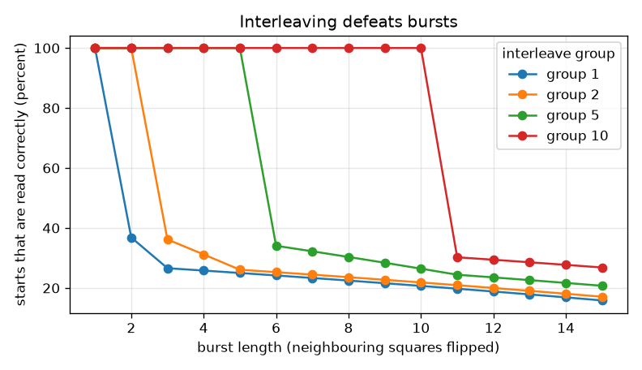
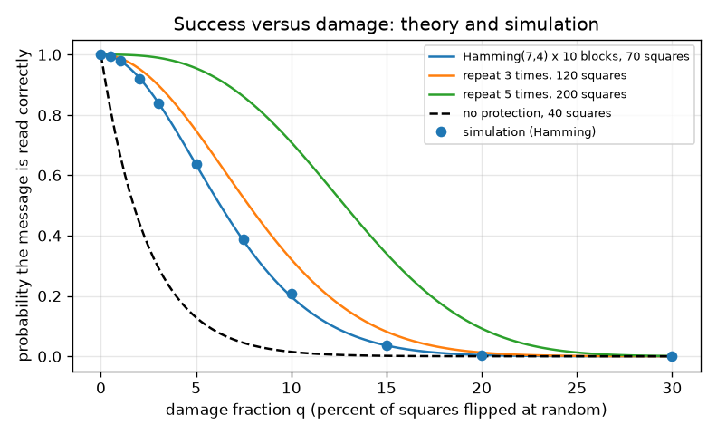
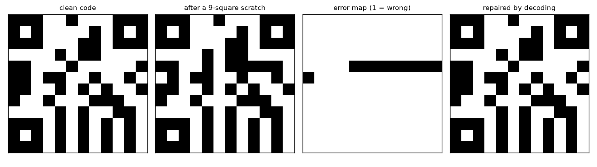

# Session 3: A toy matrix code, damaged and repaired

*Level 3 (simulation and validation) · about 90 minutes · openqrcode*

> This is a simplified educational model. It is not a validated design tool and must not be used for real structures, electrical installations, vehicles, industrial processes or medical decisions.

**Prerequisites**

- Session 1: check digits.
- Session 2: Hamming(7,4), syndrome, code rate.
- Probability of independent events (explained in Section B).

**Learning objectives.** After this session you can:

- Build a toy 2D code: message, check byte, Hamming blocks, interleaving, finder patterns.
- Damage it with random noise and with a burst, and decode it.
- Compare the measured success rate with the formula P_block^10 and with a repetition code.
- Explain why interleaving defeats bursts, and show a failure case with too much damage.

## A. Real-world problem
A QR code on a parcel is scuffed, rained on and half covered by a sticker, yet it scans. How much damage can a code take before it fails, and how should its data be laid out so that a scratch does not kill it? We answer with a toy code you can fully understand. IMPORTANT: this toy code is NOT the QR standard. Real QR codes use Reed-Solomon codes over the finite field GF(256), with four error-correction levels L, M, Q and H that can restore roughly 7, 15, 25 and 30 percent of the codewords (well-known approximate figures), plus masking, alignment and timing patterns. We borrow only the ideas. (Simplified educational model, not a validated design tool.)

## B. Concept and theory
The message is 4 letters plus a check byte (the sum of the letters mod 256): 40 bits, 10 nibbles of 4 bits. Each nibble becomes a Hamming(7,4) codeword, so 70 bits go into a 12 by 12 grid whose three corners hold 3 by 3 finder patterns. Damage model: every data square flips independently with probability q (random noise), or a run of neighbouring squares flips (a burst). A block survives if it has at most one flipped bit out of 7: P_block = (1-q)^7 + 7 q (1-q)^6 (no flips, or exactly one of the 7). The 10 blocks are independent, so the whole message survives with probability P_block^10. A hard limit follows: if more than 10 of the 70 code squares are wrong, at least one block has two or more flips (pigeonhole), and decoding must fail. A repetition code that sends each bit n times (n odd) and takes a majority vote corrects up to (n-1)/2 flips per bit; with n = 3 it needs 120 squares for the 40 bits instead of 70. Interleaving: write the codewords as rows and send the columns, so that neighbouring squares belong to different codewords. With a group of g codewords, a burst of up to g neighbouring squares hits each codeword at most once, and Hamming repairs all of it.

| Symbol | Meaning | Unit |
|---|---|---|
| q | probability that a data square is flipped (damage fraction) | no unit (0 to 1) |
| P_block | probability a 7-bit block has at most 1 flip | no unit |
| P_msg | probability the whole message is read | no unit |
| n | copies per bit in a repetition code | no unit |
| g | interleave group (codewords written together) | codewords |
| L | burst length | squares |

**Assumptions**

- Flips are independent (random noise) or one contiguous run in reading order (burst).
- The finder patterns are readable, so the grid is found.
- The decoder knows g; the check byte is the only guard against a wrong answer.
- Squares are flipped, not erased or unreadable.

$$ P_{\text{block}}=(1-q)^7+7q(1-q)^6,\qquad P_{\text{msg}}=P_{\text{block}}^{\,10} $$

$$ P_{\text{rep}}=\left[\sum_{j=0}^{t}\binom{n}{j}q^j(1-q)^{n-j}\right]^{40},\quad t=\frac{n-1}{2} $$

$$ P_{\text{none}}=(1-q)^{40} $$

## C. Visual explanation
The first figure shows the 12 by 12 toy code four times: clean, after a 9-square scratch, the error map (every wrong square marked) and the repaired code. The second figure plots the probability of reading the message against the damage fraction q: the Hamming curve falls from 1 to about 0.92 at q = 2 percent, 0.64 at 5 percent and 0.04 at 15 percent; the dots from simulation sit on the curve. Repetition codes sit higher but cost 120 or 200 squares. The third figure shows burst survival: with interleave group 10, every burst up to 10 squares is repaired; with no interleaving, already a burst of 2 can fail.

*Share of burst positions read correctly against burst length, for interleave groups 1, 2, 5 and 10.*

*Probability of reading the message against random damage: theory lines and simulation dots.*

*The toy code: clean, scratched, error map, repaired.*

## D. Interactive simulation
Run the lesson (`python start.py 3`), then open the live app: [Session 3: scratch the toy code](https://krunalpanchal1995.github.io/openqrcode/session-03/) (or `app.html` in this folder). Raise the random damage, add a scratch (burst) and switch interleaving on and off. Watch the error map and the decoded text, then open the graph and see where the damage point sits on the success curve.

**Challenge.** Make the code readable despite a scratch of 8 to 10 squares and at most 1 percent random damage.

## E. Worked example and experiment
**Problem.** At q = 5 percent random damage, what is the probability that the toy code is read correctly? Compare with a simulation.

1. No flips in a block: (0.95)^7 = 0.6983.
2. Exactly one flip in a block: 7 x 0.05 x (0.95)^6 = 0.35 x 0.7351 = 0.2573.
3. P_block = 0.6983 + 0.2573 = 0.9556.
4. All 10 blocks must survive: P_msg = 0.9556^10 = 0.635.
5. A simulation of the whole pipeline (build, damage, decode) with thousands of trials gives about 0.63 to 0.64, matching the formula.

**Answer.** About 0.635: the toy code is read correctly in roughly 63 or 64 of 100 attempts at 5 percent random damage.

**Experiment.** Print the toy code on paper (use the figure), photocopy it badly, and mark with a pen random squares you flip by hand at 5 percent (about 3 or 4 of 70). Decode with the lesson. Compare how often you succeed over several tries with 0.635. Differences come from small samples (10 tries give a wide spread) and from real damage not being independent: stains and scratches come in clumps, which is why bursts and interleaving matter. Real QR readers also see blur and shadows, which this model ignores.

## Real-world application and mini-project: Choose the interleaving for a scratched parcel label
A courier prints the toy code on parcels, and rollers scratch it with bursts of up to 7 neighbouring squares (in reading order). Session 3 lets you pick an interleave group of 1, 2, 5 or 10 codewords. Find the smallest group for which every burst of 1 to 7 squares, at every possible start position, is still read correctly.

**Deliverable:** A script that prints, for each group (1, 2, 5, 10) and each burst length from 1 to 12, the percentage of start positions that are read correctly, names the smallest group that survives every burst up to 7 squares, and saves the table as a picture.

**Success looks like:** The script reports group 10 (the groups 1, 2 and 5 read only 23, 24 and 32 percent of the bursts of 7 squares), and it also reports that random damage of 2 percent is read with probability about 0.92, whatever the group.

## F. Assessment and design challenge
**Question type A: Conceptual.** Why does writing the codewords as rows and sending the columns (interleaving) help against a scratch, even though it adds no new bits?

Hint

Where do the 7 bits of one codeword sit on the grid with and without interleaving?

Step-by-step solution

Without it the 7 bits of a codeword are neighbours, so a scratch of 2 squares puts 2 flips into one block, and Hamming cannot repair that. With group 10 the bits of one codeword are 10 squares apart, so a scratch of up to 10 squares hits each codeword at most once. The total number of flips is the same, but they are spread over many blocks, each with at most one: repairable.

**Question type B: Numerical.** For q = 2 percent, find P_block and P_msg for the toy code, and say how many of 100 parcels you expect to read.

Hint

P_block = (1-q)^7 + 7q(1-q)^6, then raise to the power 10.

Step-by-step solution

(0.98)^7 = 0.8681 and 7 x 0.02 x (0.98)^6 = 0.14 x 0.8858 = 0.1240, so P_block = 0.9921. P_msg = 0.9921^10 = 0.924. About 92 of 100 parcels. Sanity check: the lesson table prints 0.9242 for q = 0.02.

**Question type C: Graph and simulation interpretation.** In the success-versus-damage graph, at about which damage do the Hamming and the no-protection curves differ most, and what does the dashed line at 15.7 percent mean?

Hint

Look where the gap between the curves is largest and recall that 11 of the 70 code squares is the pigeonhole limit.

Step-by-step solution

They differ most at small damage, around 2 to 4 percent, where Hamming still reads 92 to 84 percent of codes while the unprotected 40 squares read only 45 to 30 percent. The dashed line at 11 / 70 = 15.7 percent marks the hard limit: with more than 10 wrong code squares some block must have two flips, so success is impossible beyond it. In practice success already collapses below 5 percent, long before the limit, because random flips pile up in some blocks.

**Question type D: Design and optimisation challenge.** Design: a label gets bursts of up to 7 squares. You may choose the interleave group 1, 2, 5 or 10. Which do you pick, and what is the price of choosing the largest group when random noise is also present?

Hint

Use the guaranteed burst length (the largest burst that is always repaired) for each group from the lesson.

Step-by-step solution

The guaranteed burst length equals the group (1, 2, 5, 10 measured), so only group 10 handles 7. The measured survival of bursts of 7 squares is 23, 24 and 32 percent for groups 1, 2 and 5 and 100 percent for group 10. The price: interleaving costs nothing in extra bits and does not change the random-noise success (about 92 percent at q = 2 percent for every group), but the decoder needs all 10 blocks in one pass and the layout is harder to read by hand. Trade-off: no capacity cost, only complexity.

Score yourself with [RUBRIC.md](../../RUBRIC.md). Print the [activity sheet](activity_sheet.md) to work on paper.

## Common misconceptions
| Common misconception | What is actually true |
|---|---|
| A code that fixes 1 error in 7 bits can take 14 percent damage. | Only in the best case, where the damage is perfectly spread. With random damage the success rate is already low at 5 percent. |
| Interleaving adds protection. | It adds none: it re-arranges the bits so that a burst looks like scattered single flips. Random noise is not helped at all. |
| Our toy code is how QR codes work. | No: real QR codes use Reed-Solomon codes over GF(256) that correct whole bytes, with levels L, M, Q, H restoring roughly 7, 15, 25 and 30 percent of the codewords. |
| If decoding returns text, the text is right. | With 2 or more flips in a block the decoder returns a wrong word; only the check byte catches it, and it can miss it (rarely). |

## Glossary
- **finder pattern**: a fixed square pattern in a corner that tells the reader where the code is
- **burst**: a run of neighbouring squares damaged together, such as a scratch
- **interleaving**: re-ordering the bits so that neighbours belong to different codewords
- **repetition code**: send every bit n times and take a majority vote
- **Reed-Solomon code**: the family of codes real QR codes use; it works on bytes, not single bits
- **pigeonhole limit**: more flips than blocks forces some block to have two

## Finish
1. Do the three coding tasks in [exercises.md](exercises.md).
2. Run `python start.py 3` again after your changes. It ends with the checkpoint; when it prints `PASS`, you are done. (Checkpoint only: `python start.py check 3`.)

Next: the [roadmap](../../promo/roadmap.md). Session 4 is yours to build.
